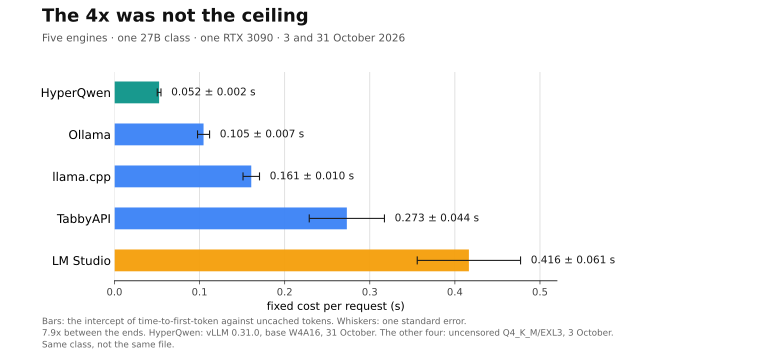

# LocBench

**A measurement bench for local LLM inference — the numbers out front, the
method next to them.**

[](https://github.com/LocBench/locbench/actions/workflows/checks.yml)

> **What it found**
>
> - Five engines, one 27B class, one RTX 3090, one clock: the fixed cost per
>   request runs from **0.0525 s to 0.416 s** — a **7.9x** spread before the
>   first token.
> - The first four engines spanned 4.0x. A fifth engine, added later, halved the
>   best case: the 4x was not the ceiling.
> - The ranking does not survive a smaller model: on an 8B, llama.cpp 0.040 s
>   and Ollama 0.046 s are **6 ms apart at 0.4σ**.
> - On this machine LM Studio had picked its **Vulkan** build: **729 tok/s**
>   where llama.cpp gets **1145** on the same file.
>
> Measured 3 October 2026 (the four engines) and 31 October 2026 (the fifth).
> [The fifth-engine piece](pieces/03-the-4x-was-not-the-ceiling.md) ·
> [The four-engine piece](pieces/02-what-a-request-costs-before-it-starts.md) ·
> [The method](PROTOCOL.md) · [Rerun it](#redo-everything-the-protocol-claims-from-zero)



Local inference on the internet is full of opinions and poor in measurements.
People publish token/s without saying at what context length, with what cache
fraction, on which engine, at which version. Those numbers cannot be compared to
anything, not even to themselves a week later.

LocBench does the other thing: **one variable at a time, the environment
declared, the raw data published, and a section on what the measurement does not
control.**

## Where it starts

Read the source of two engines and you find the same thing.

TabbyAPI, over exllamav3 — `backends/exllamav3/model.py:1442-1447`:

```python
prompt_time = round(result.get("time_prefill"), 2)
prompt_ts = (
    "Indeterminate"
    if prompt_time == 0
    else round((prompt_tokens - cached_tokens) / prompt_time, 2)
)
```

and `time_prefill` is documented in exllamav3, `generator/generator.py:498`, as

```
"time_prefill": float  - time to first token, in seconds
```

llama.cpp computes the same quantity in `tools/server/server-common.h` — uncached
tokens over a window that opens when the slot picks up the prompt and closes once
the first token has been sampled and the context synchronised. The comment in the
source says why the measurement is taken there.

So the field everyone reads and compares, `prompt_tokens_per_sec`, is:

```
uncached_prompt_tokens / time_to_first_token
```

A latency window carrying a throughput name. On 98 real requests through a
logging proxy (87 usable, one RTX 3090):

```
time_to_first_token = 0.447 s + uncached_tokens / 943 tok/s        R² = 0.953
```

At 200 uncached tokens it reports **303 tok/s**. And that is not the end of it:
the data carries a confound that makes it a hypothesis rather than a measurement,
and the protocol says so before the numbers.

The whole story is in [`PROTOCOL.md`](PROTOCOL.md), together with the three
questions that turn that hypothesis into a measurement, or demolish it.

Published so far: [`pieces/`](pieces/) — starting with
[what `prompt_tokens_per_sec` actually measures](pieces/01-what-prompt-tokens-per-second-measures.md),
then
[what an engine charges you before it does any work](pieces/02-what-a-request-costs-before-it-starts.md),
where the metric is measured under control on four engines, and then
[the 4x was not the ceiling](pieces/03-the-4x-was-not-the-ceiling.md), where a
fifth engine halves the best case and the spread becomes 7.9x.

## Layout

```
CONTRIBUTING.md           what to send when a number does not reproduce
CITATION.cff              how to cite the measurements
PROTOCOL.md               what we measure, how, and what we do NOT control
bench/measure.py           the client: builds the prompts, sends them, records raw
bench/compare_engines.py   one cell, several engines, both clocks, and the gap
bench/analyze_log.py       redoes the September analysis from the raw data
bench/analyze_d1.py        one cell of D1, fitted across the lengths
bench/plot_fixed_cost.py   the four engines on one clock, as a picture
bench/plot_fixed_cost_five.py  the fifth engine, and the 7.9x
bench/run_hyperqwen.sh     the fifth-engine campaign, with its key and warm-up
bench/plot_social_preview.py  the 1280x640 card for the repository and X
bench/environment.sh       the machine and the engine versions, as a card
bin/verify_piece.py        the gate: citations, quoted code and numbers in a piece
bin/verify_post.py         post texts against the platform character limits
bin/fetch-sources.sh       the pinned engine sources, downloaded once
bin/reproduce.sh           everything below, in one command
data/                      the raw JSONL, one line per request, committed
tests/                     the arithmetic and the gates, verified
pieces/                    the published pieces, and the posts that go with them
```

Redo everything the protocol claims, from zero:

```bash
bin/reproduce.sh
```

It fetches the pinned engine sources, reruns the September analysis and the
four-engine comparison, checks the four-engine chart, the card and the fifth
engine, runs both gates and the tests. The individual commands are in the
script, in the order they run.

## The engines

Ollama · llama.cpp · LM Studio · EXL3 (TabbyAPI), on the same machine.

## The rules

1. **One variable at a time.** Change two and you cannot tell which caused the
   difference
2. **Publish the median, not the mean**, with the interval
3. **Discarded measurements are recorded**, with the reason: the ones that
   vanish without explanation are how a measurement bench lies
4. **Everything is redone with one command**, from the raw data
5. **A comparison uses one clock.** An engine's own reported window is a
   cross-check, never the source: the four engines do not time the same
   interval, and two of them publish no timing at all. Ranking engines means
   timing every one of them with the client, in streaming, where that clock
   exists

## Licence

Code is [MIT](LICENSE). The measurements in `data/` are
[CC BY 4.0](LICENSE-DATA) — reuse them, redo them, build on them; just say where
they came from. A measurement nobody may reuse is a measurement nobody can check,
and being checkable is the whole claim.

## Status

Last measurement: **31 October 2026** (the fifth engine); the four-engine
campaign is 3 October. Next: the same-checkpoint control and a same-session
five-engine rerun.

The protocol is written, the three controlled experiments (D1, D2, D3) have been
run on four engines, and the fifth engine extended the comparison on 31 October.
Every number in the three published pieces is recomputed from the committed data
by `bin/verify_piece.py`.

The method changed while doing it, and that is the most useful thing here: **the
engine's own reported window is not one instrument read four times.** Over
identical streamed requests, llama.cpp's leaves 63 ms of each request untimed
and TabbyAPI's 124. So the ranking column is the client's clock, over streamed
requests, where one clock times one interval for every engine — and the engine's
own number is kept beside it as the cross-check it always was.

What is not done is in the pieces, item by item, rather than in a footnote:
one machine, one card, two model classes, five engines, and prompts that are
still not anyone's real workload.

The pieces published so far are in [`pieces/`](pieces/).

**A number that does not reproduce is the most useful thing you can send:**
see [`CONTRIBUTING.md`](CONTRIBUTING.md).

## Who

LocBench is built and measured by [@GiovanniOsserv1](https://x.com/GiovanniOsserv1)
on one RTX 3090. The numbers are mine; the mistakes are mine too, and the
corrections are the point.

LocBench is independent: no engine vendor paid for, reviewed, or approved these
measurements. When a number is wrong, the correction is published with the data.

> Everything here is in English: this file, the protocol, the pieces, the commit
> messages, the file and directory names, the analysis output and the CSV column
> names. Nothing is left in another language for a reader to stumble into.

One exception, and it is a recorded value rather than a sentence. The `client`
field of `data/2026-09-usage.jsonl` carries whatever name each request sent —
`batteria/1.0`, `prova-effort/low`, `salute-gpu/1.0` — because those are the
names the throwaway scripts called themselves by. The protocol declares them and
says where they came from; rewriting them would be editing the measurement to
tidy the prose. **Names chosen here are held to the rule; values recorded are
published as recorded.** `tests/test_language.py` enforces the first half.
